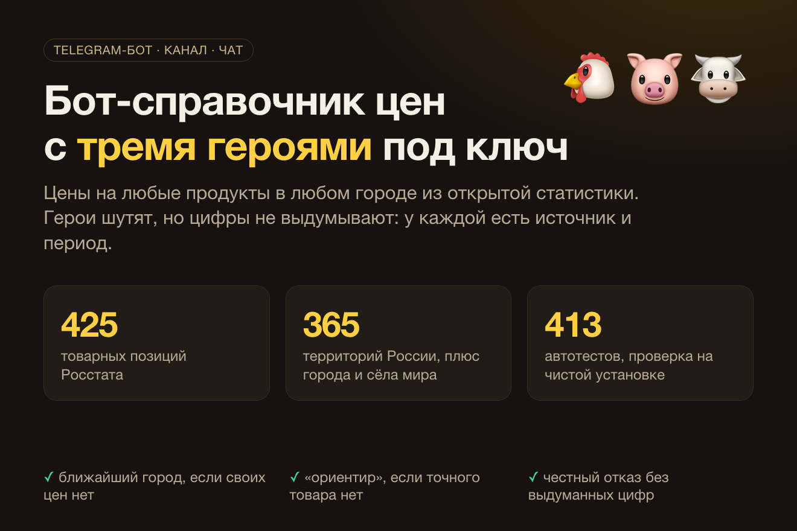

# Мясная Троица — Telegram-бот цен на продукты, канал и чат

**Работающий проект:** бот [@myasnaya_troitsa_bot](https://t.me/myasnaya_troitsa_bot) · канал [@basketmarket](https://t.me/basketmarket)

Справочник цен на продукты, где на любой вопрос отвечают три героя с характером: Курица, Свинья и Корова. Герои шутят, но цифры не выдумывают: цены берёт код из открытых данных, у каждой есть источник и период.

> Исходный код закрытый. Здесь описание проекта.

## Что умеет

- **Любые товары и места:** около 425 товарных позиций Росстата по примерно 365 территориям России, поиск среди ~33 тыс. городов и сёл мира с падежами («в Нише»).
- **Честные ответы:** нет цен в месте, берётся ближайший город с названным расстоянием; нет точного товара, берётся ближайшая группа с пометкой «ориентир»; данных нет, бот говорит об этом.
- **Свободные вопросы:** уточнения («а в Оренбурге?»), набор на неделю, рецепты из холодильника, память разговора.
- **Канал и чат:** 10 рубрик по расписанию (утренний дайджест, недельный индекс, «город против Москвы», «продукт недели», «что подорожало за месяц» и др.). Пост без источника и периода в канал не уходит.
- **Без ИИ тоже работает:** упрощённый режим с реальными ценами и честными отказами.

## Надёжность

Автообновление данных с изоляцией сбоев (при сбое остаются прошлые значения), запуск как служба Linux с автоперезапуском, 413 автотестов в комплекте под ключ.

## Стек

## Автор

Олег · [gonka.blog](https://gonka.blog) · textsmen@gmail.com
